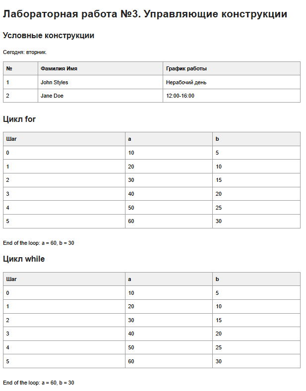
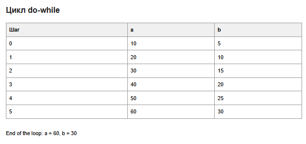

# Лабораторная работа №3. Управляющие конструкции

## Запуск

Для проверки синтаксиса:

```bash
php -l index.php
```

Для просмотра страницы можно запустить встроенный сервер PHP из папки проекта:

```bash
php -S localhost:8000
```

После этого открыть в браузере `http://localhost:8000`.

## Условные конструкции

Функция `date('N')` возвращает номер текущего дня недели: от `1` для понедельника до `7` для воскресенья.

- Для John Styles рабочими являются понедельник, среда и пятница. Его график: `8:00-12:00`.
- Для Jane Doe рабочими являются вторник, четверг и суббота. Ее график: `12:00-16:00`.
- В остальные дни выводится `Нерабочий день`.

Для проверки принадлежности дня к списку используется `in_array()` с третьим параметром `true`, чтобы сравнение было строгим.

## Циклы

В каждом цикле выполняется шесть итераций: от `0` до `5`. На каждой итерации к `$a` прибавляется `10`, а к `$b` прибавляется `5`. Поэтому итоговые значения равны:

```text
a = 60, b = 30
```

Промежуточные значения выводятся в таблицах для каждого из циклов:

- `for` объединяет инициализацию, условие и изменение счетчика в одной конструкции.
- `while` сначала проверяет условие, поэтому тело может не выполниться ни разу.



- `do-while` сначала выполняет тело, а затем проверяет условие, поэтому тело выполняется минимум один раз.



## Ответы на контрольные вопросы

### 1. Разница между `for`, `while` и `do-while`

`for` удобно использовать, когда заранее понятны начальное значение счетчика, условие продолжения и шаг изменения. Например, когда нужно выполнить цикл определенное количество раз.

`while` подходит, когда количество повторений заранее неизвестно, а выполнение должно продолжаться, пока условие истинно. Условие проверяется до входа в тело цикла.

`do-while` используют, когда тело нужно выполнить хотя бы один раз, а проверку условия сделать после первой итерации.

### 2. Тернарный оператор `? :` в PHP

Тернарный оператор является сокращенной формой `if-else`:

```php
$result = $condition ? $valueIfTrue : $valueIfFalse;
```

Если `$condition` истинно, в `$result` попадет `$valueIfTrue`, иначе — `$valueIfFalse`.

### 3. Что произойдет, если условие `do-while` изначально ложно?

Тело `do-while` все равно выполнится один раз, потому что условие проверяется только после выполнения тела. После этого цикл завершится, если условие окажется ложным.